# 量化选股系统 · 数据库设计文档

> 规模：**53 张表** / **439 条字段注释**｜ 配套产物：可执行 DDL `量化选股系统·数据库DDL.sql`、可视化 ER 图 `量化选股系统·数据库ER图.html`。
> 对齐：《系统设计总文档》§6（数据架构）；需求口径见《需求文档》。

**本文档（+ DDL）是库表设计的唯一权威**：《系统设计总文档》§6 只定义**存储选型、分域职责与写入归属**，表 / 字段 / 约束 / 分区 / 索引一律以本文档与 DDL 为准，**不在总文档重复定义**。

本文件把 §6 的分域决策展开为**可直接落库的完整设计**：字段类型、键约束、跨域外键、按年分区与索引约定。**字段口径最终以 DDL 为准**，本文档与 DDL 互为校验，二者不一致时以 DDL 为准并视为文档缺陷。

---

## 1. 总体设计

- **唯一持久化库**：PostgreSQL，**按 schema 分域**，表名裸名，引用写 `<schema>.<table>`。
- **缓存**：Redis 只做热点数据 / 信号缓存（TTL 5–15 分钟），**不存业务持久化数据**，丢失须能从 PG 重建；不可用仅允许功能降级。
- **采数与展示解耦**：采集侧（Python CLI）写库；Web 站点**只读库**渲染；数据库是二者唯一接口。
- **跨域约束**：跨域只读引用、禁止跨域写入；`common` 只允许初始化脚本与 **AD-09 数据管理**维护写。

---

## 2. 数据分域（8 schema）

| 域（schema） | 写方 | 主要表 |
|------|------|--------|
| `market` 行情库 | 各采数 Agent，按频率拆分为 5 个独立任务 | security · daily_bar · index_daily · industry_daily · etf_daily · chip_summary · announcement_event · **macro_indicator（含 freq 分频）** · **meso_monthly** |
| `factor` 因子库 | lab-factor / agent-micro | factor_def · factor_value · factor_version · factor_report · factor_eval |
| `signal` 信号库 | assemble-risk / 各层引擎 | macro_signal · **macro_aux_signal（本期零产出 · D-30）** · **macro_forecast** · industry_rank · **meso_nowcast** · stock_score · signal · advice_batch · advice_node |
| `portfolio` 组合库 | portfolio | portfolio · position · order_proposal · trade · daily_mark |
| `metric` 计量库 | tracking / backtest / lab-factor | signal_tracking · winrate_stat · backtest_task · backtest_result |
| `task` 任务与调度 | 全部 CLI；AD-09 写 rerun_request；**AD-11 写 job_def** | task_run · **agent_run** · schedule_config · **job_def** · **job_instance** · **data_item** · **data_ref** · **run_log** · quality_alert · source_health · **rerun_request** |
| `common` 主数据 | 初始化 / AD-09 | trade_calendar · industry · industry_etf_map · industry_constituent |
| `platform` 平台 | Web 站点（管理端） | admin_user · role · permission · admin_role · role_permission · audit_log |

---

## 3. 表目录（关键字段 + 约束 + 分区）

### 3.1 `common` 主数据
| 表 | 主键 | 关键字段 | 备注 |
|----|------|----------|------|
| trade_calendar | trade_date | is_open / is_month_start / is_month_end | 交易日历；跑批时点断言依据 |
| industry | industry_code | industry_name / level(1/2/3) / parent_code(自引用) / standard=SW | 申万口径唯一基准，禁止东财 JOIN |
| industry_etf_map | (industry_code, etf_code) | is_primary | 行业↔ETF 映射 |
| industry_constituent | (industry_code, symbol, in_date) | out_date / is_current | 成分股口径（point-in-time） |

### 3.2 `market` 行情库
| 表 | 主键 | 关键字段 | 分区 |
|----|------|----------|------|
| security | symbol | name / industry_code(FK common.industry) / list_date / delist_date / is_st | — |
| daily_bar | (symbol, trade_date) | o/h/l/c / volume / amount / adj_factor / source / run_id | **按年** |
| index_daily | (index_code, trade_date) | o/h/l/c / volume / amount / source | **按年** |
| industry_daily | (industry_code, trade_date) | o/h/l/c / amount / pe / pb / total_cap / a_float_cap | **按年** |
| etf_daily | (etf_code, trade_date) | o/h/l/c / volume / amount | **按年** |
| chip_summary | (symbol, trade_date) | profit_rate / avg_cost / conc90 / conc70 | **按年** |
| announcement_event | id | symbol / publish_at / tag_id / title / url / sentiment / UNIQUE(symbol,url) | — |
| **macro_indicator** | (indicator_code, **freq**, period) | indicator_name / val / unit / yoy / **freq(D 日频 / M 月频 / Q 季频)** / publish_time / source / run_id / **updated_at** | 宏观指标原始值，按 freq 分频：月频 CPI / 社融等，10–20 日落库；日频由 AG-07 采集，只作辅助信号（SC-08） |
| **meso_monthly** | (industry_code, period, metric_code) | metric_name / val / yoy / source / run_id / updated_at | **中观月频低频数据**（行业景气/产量/库存/财务聚合，AG-08）；缺失时行业打分降级（MD-07） |

### 3.3 `factor` 因子库
| 表 | 主键 | 关键字段 | 备注 |
|----|------|----------|------|
| factor_def | (factor_code, version) | name / dimension / formula / params_json / status(draft/approved/retired) | 因子定义（版本化） |
| factor_value | (symbol, trade_date, factor_code) | raw_value / std_value / neutral_value / version(FK) | **按年** |
| factor_version | version | weights_json / snapshot_json / rollback_of | 因子权重快照 |
| factor_report | report_id | factor_code(FK) / version / content_json / report_url | AI 挖掘审批后生成 |
| factor_eval | (factor_code, version) | ic_mean / ir / turnover / mono_score / passed | 因子评价 |

### 3.4 `signal` 信号库
| 表 | 主键 | 关键字段 | 备注 |
|----|------|----------|------|
| macro_signal | as_of | regime / money_credit(组合枚举) / 四维因子 / equity_weight / style_json / asset_alloc_json / confidence / **signal_json（JSONB·完整 MacroSignal 契约 §1.7）** | 月频，仅最新已发布期；`signal_json` 为只读派生展示层，存完整信号契约（regime/phase/money_credit/asset_alloc/factors/vintage/forecast_signals），不参与周期字段计算、不触发 confidence_delta；rate 与 hf_check 已按 D-30 移除 |
| **macro_aux_signal** | (as_of, trade_date) | dr001 / dr001_ma20 / dr001_pctile / dr001_extreme / warn_flags(JSONB) / aux_note / run_id | **日频辅助信号专用表**（C-12 / D-18）。只供展示、预警与交易层；**铁律**：本表任何列不得参与 `macro_signal` 的 regime / phase / money_s / credit_s / equity_weight_base / style_json / asset_alloc_base_json / confidence 计算，也不得触发 confidence_delta。本期**零产出**（D-30 后移），表结构先建 |
| **macro_forecast** | signal_id | chain / basis_period / lead_window / direction / confidence / hit_rate_status / invalid_if / as_of | **预测信号**（§1.15.2 契约 · D-19）。本期实现；`hit_rate_status=pending` 时页面输出「待回测」，禁止前端另算命中率；只读派生，不设回写 `macro_signal` 的路径 |
| industry_rank | (industry_code, trade_date) | momentum_s / valuation_s / fundflow_s / crowding_s / total_score / rank / etf_code / weight | 中观 |
| **meso_nowcast** | (industry_code, trade_date) | pe_pctile / fundflow_pctile / crowding_pctile / leverage_pctile / direction / block_new_entry / run_id | **中观辅助四项快照**（§2.2.3.0）。四项均在微观计分，此处只存方向与分位快照；**铁律**：任何列不得参与 `industry_rank.total_score`；唯一例外 `block_new_entry=true` 只拦新增、不改清单与分数 |
| stock_score | (symbol, trade_date) | industry_code / 五维评分 / total_score / rank_in_industry / rank_all / advice | 微观 |
| signal | id | symbol(FK) / trade_date / source_layer / score / entry_price_ref / strategy_ver / reason_json / UNIQUE(symbol,trade_date,source_layer,strategy_ver) | 三层信号汇总 |
| advice_batch | batch_id | as_of / equity_weight / asset_alloc_json / status | 投资建议批次 |
| advice_node | id | batch_id(FK) / parent_id(自引用) / node_type / name / weight / target_json / reason_json | 思维导图；**对外裁剪只投影 name/weight** |

### 3.5 `portfolio` 组合库
| 表 | 主键 | 关键字段 | 备注 |
|----|------|----------|------|
| portfolio | id | name / kind(virtual/live) / cash / base_currency | 组合 |
| position | id | portfolio_id(FK) / symbol / qty / cost_price / weight | 持仓 |
| order_proposal | id | portfolio_id(FK) / symbol / side / qty / price_ref / status / confirmed_at | 下单建议 |
| trade | id | portfolio_id(FK) / symbol / side / qty / price / fee / proposal_id(FK) | 成交 |
| daily_mark | (portfolio_id, trade_date) | market_value / pnl / cum_pnl / benchmark_nav | 每日净值 |

### 3.6 `metric` 计量库
| 表 | 主键 | 关键字段 | 备注 |
|----|------|----------|------|
| signal_tracking | id | signal_id(FK) / horizon / ret / excess_ret / win / UNIQUE(signal_id,horizon) | 信号跟踪 |
| winrate_stat | (source_layer, industry_code, horizon, stat_date) | samples / win_rate / avg_ret / avg_excess / profit_loss_ratio | 胜率统计（**TK 唯一口径源**） |
| backtest_task | id | params_json / data_version / status | 回测任务 |
| backtest_result | id | task_id(FK) / 年化/波动/Sharpe/Sortino/最大回撤/Calmar/胜率/换手/IC/IR / net_value_json | 回测结果 |

### 3.7 `task` 任务与调度
| 表 | 主键 | 关键字段 | 备注 |
|----|------|----------|------|
| task_run | id | task_code / run_id / status(running/done/skipped/failed) / window_date / rows / error / source_stats | 任务运行 |
| **agent_run** | id | agent_code(macro-daily / macro-monthly / meso-daily / meso-monthly / micro) / run_id / data_items(JSON) / rows_fetched / missing_json(JSON) / latency_ms | Agent 采集清单与缺失明细（AG-06，AD-02 展示；**按频率独立任务上报**） |
| schedule_config | task_code | cron_expr，系统侧默认基线：日频 `0 2 * * *`、宏观月频 `0 2 10-20 * *` / enabled / updated_by | 系统 cron 基线（9:30–15:00 拒保存）；**实际执行以 WorkBuddy 自动化任务为准（job_def）** |
| **job_def** | job_key | job_name / freq(daily/monthly/weekly/manual) / cron_expr(5 段) / cli_command / params_json / **automation_id** / run_node / retry_cnt / timeout_sec / enabled / updated_by | **WorkBuddy 任务定义基线**。AD-11 管控启停 / cron / 补跑；`automation_id` 为平台标识；入版本库可恢复；线上不持调度（C-11） |
| **job_instance** | id | job_key(FK 逻辑) / run_id / **automation_run_id** / trigger_type(auto/manual/rerun) / scheduled_at / started_at / ended_at / duration_ms / status / exit_code / retry_cnt / log_summary / operator | **任务执行实例**。AD-11 执行历史与日志；`automation_run_id` 为平台侧执行流水号；与 task_run、agent_run 以 run_id 串联 trace |
| **rerun_request** | id | agent_code(按频率) / date_from / date_to / data_type / target_keys(JSON) / requested_by / status(pending/running/done/failed) | AD-09 补跑重跑请求。按日期与数据类型组合，禁止无条件全量；由 WorkBuddy 自动化任务拉起 |
| **data_item** | id | name(全库唯一) / freq / factor_layer / api / publish_slot / job_code / rows / latest_period / gap_periods / last_fetch_at / status | **数据项主表**（AD-02 数据管理页）。`id` = 数据项编码、不可改；`name` 全库唯一、可改；**删除判引用只走 `data_item.id`**（键口径见策略 §4.5 ⑥），禁止按名称比对 |
| **data_ref** | id | data_id(FK data_item.id) / used_by / kind(strategy/report) / note | **数据项引用关系**。UNIQUE(data_id, used_by)；删数据项时按此清残留（R-AD-9） |
| **run_log** | id | started_at / job_code / item_ids(JSONB 编码数组) / err_type / result_text / lv(wait/done) / retry_cnt / trigger_type / cost_ms / detail_msg | **运行日志**。保留表与三态语义，**本期无任何页面消费**；仍服务删除连带清除（R-AD-9 / R-AD-11） |
| quality_alert | id | task_code / data_item / check_type / severity / detail | 质量告警 |
| source_health | source | status / last_trade_date / latency_ms / checked_at | 数据源健康 |

### 3.8 `platform` 平台
| 表 | 主键 | 关键字段 | 备注 |
|----|------|----------|------|
| ~~user~~ | — | — | 外部用户账户，支撑页面已下线、无调用方，不建表 |
| admin_user | id | username / password_hash / mfa_secret / status | 管理端账号（**系统内唯一账号体系**） |
| role / permission | id | code(唯一) / name | 角色与权限 |
| admin_role | (admin_id, role_id) | FK→admin_user / role | 账号-角色 |
| role_permission | (role_id, permission_id) | FK→role / permission | 角色-权限 |
| audit_log | (id, created_at) | actor_type / actor_id / action / object / before / after / ip | **按年**分区 |

---

## 4. 核心关系（外键清单）

| 子表.字段 | → 父表.字段 | 说明 |
|-----------|-------------|------|
| market.security.industry_code | common.industry.industry_code | 个股行业归属 |
| market.industry_daily.industry_code | common.industry.industry_code | 行业日行情 |
| common.industry.parent_code | common.industry.industry_code | 行业层级自引用 |
| common.industry_constituent.industry_code | common.industry.industry_code | 成分股行业归属 |
| common.industry_etf_map.industry_code | common.industry.industry_code | 行业 ETF 映射 |
| factor.factor_value.(factor_code,version) | factor.factor_def.(factor_code,version) | 因子取值 |
| factor.factor_report.(factor_code,version) | factor.factor_def.(factor_code,version) | 因子报告 |
| factor.factor_eval.(factor_code,version) | factor.factor_def.(factor_code,version) | 因子评价 |
| signal.industry_rank.industry_code | common.industry.industry_code | 行业排名 |
| signal.stock_score.industry_code | common.industry.industry_code | 个股评分行业归属 |
| signal.stock_score.symbol | market.security.symbol | 个股评分 |
| signal.signal.symbol | market.security.symbol | 信号标的 |
| signal.advice_node.batch_id | signal.advice_batch.batch_id | 建议节点批次 |
| signal.advice_node.parent_id | signal.advice_node.id | 节点树自引用 |
| portfolio.position.portfolio_id | portfolio.portfolio.id | 持仓所属组合 |
| portfolio.order_proposal.portfolio_id | portfolio.portfolio.id | 建议单所属组合 |
| portfolio.trade.portfolio_id | portfolio.portfolio.id | 成交所属组合 |
| portfolio.trade.proposal_id | portfolio.order_proposal.id | 成交对应建议 |
| portfolio.daily_mark.portfolio_id | portfolio.portfolio.id | 估值所属组合 |
| metric.signal_tracking.signal_id | signal.signal.id | 信号跟踪 |
| metric.winrate_stat.industry_code | common.industry.industry_code | 胜率统计行业 |
| metric.backtest_result.task_id | metric.backtest_task.id | 回测结果 |
| signal.meso_nowcast.industry_code | common.industry.industry_code | 中观辅助快照行业归属 |
| task.data_ref.data_id | task.data_item.id | 数据项引用（删除判引用的唯一依据） |
| platform.admin_role.* | platform.admin_user / role | 账号角色 |
| platform.role_permission.* | platform.role / permission | 角色权限 |

---

## 5. 分区与索引约定

- **按年分区**：`market.daily_bar / index_daily / industry_daily / etf_daily / chip_summary`、`factor.factor_value`、`platform.audit_log`，使用 `PARTITION BY RANGE (trade_date | created_at)`，由函数 `task.create_yearly_partition` 生成 2020–2030 年子分区。
- **主键即分区键的一部分**：时序表主键含 `trade_date`（或 `created_at`），保证分区裁剪有效。
- **高频索引**：`(trade_date)`、`(trade_date, industry_code)`、`(trade_date, total_score DESC)`、`(symbol, trade_date)`、`(published_at)`，`(task_code, window_date)` 等（见 DDL §10）。
- **禁止长事务**跨越跑批窗口；批量 upsert 写入。

---

## 6. 数据类型与命名约定

- 代码类（symbol / code）：`VARCHAR(20)`（A 股如 `600000.SH`）。
- 价格 / 金额：`NUMERIC(18,4)`；大额金额 `NUMERIC(28,4)`。
- 比率 / 评分 / 权重：`NUMERIC(12,6)`；置信度 `NUMERIC(5,4)`。
- JSON：`JSONB`；时间戳：`TIMESTAMPTZ`（默认 `now()`）。
- 代理主键：`BIGINT GENERATED ALWAYS AS IDENTITY`。
- 分区子表命名：`<schema>.<table>_<year>`。

---

## 7. ER 图

> 下图为全量实体关系；实体名以 `schema_` 前缀区分分域。完整可缩放交互版见 `量化选股系统·数据库ER图.html`。

```mermaid
erDiagram
  common_industry                ||--o{ common_industry : "parent/child"
  common_industry                ||--o{ common_industry_etf_map : "has_etf"
  common_industry                ||--o{ common_industry_constituent : "has_constituent"
  common_industry                ||--o{ market_security : "classifies"
  common_industry                ||--o{ market_industry_daily : "prices"
  common_industry                ||--o{ signal_meso_nowcast : "nowcast"
  common_industry                ||--o{ signal_industry_rank : "ranks"
  common_industry                ||--o{ signal_stock_score : "classifies"
  common_industry                ||--o{ metric_winrate_stat : "stats"
  market_security                ||--o{ market_daily_bar : "bars"
  market_security                ||--o{ market_chip_summary : "chips"
  market_security                ||--o{ market_announcement_event : "events"
  market_security                ||--o{ signal_stock_score : "scores"
  market_security                ||--o{ signal_signal : "signal"
  market_security                ||--o{ factor_factor_value : "factor_for"
  market_etf_daily               |o--o{ common_industry_etf_map : "maps"
  factor_factor_def              ||--o{ factor_factor_value : "values"
  factor_factor_def              ||--o{ factor_factor_report : "report"
  factor_factor_def              ||--o{ factor_factor_eval : "eval"
  signal_advice_batch           ||--o{ signal_advice_node : "nodes"
  signal_advice_node            ||--o{ signal_advice_node : "parent/child"
  signal_macro_signal           |o--o{ signal_advice_batch : "as_of"
  signal_signal                 |o--o{ metric_signal_tracking : "tracked"
  portfolio_portfolio           ||--o{ portfolio_position : "positions"
  portfolio_portfolio           ||--o{ portfolio_order_proposal : "proposals"
  portfolio_portfolio           ||--o{ portfolio_trade : "trades"
  portfolio_portfolio           ||--o{ portfolio_daily_mark : "marks"
  portfolio_order_proposal      |o--o{ portfolio_trade : "fills"
  metric_backtest_task          ||--o{ metric_backtest_result : "result"
  task_data_item                 ||--o{ task_data_ref : "referenced_by"
  task_schedule_config          |o--o{ task_task_run : "runs"
  task_job_def                  ||--o{ task_job_instance : "instances"
  task_job_instance             |o--o{ task_task_run : "trace(run_id)"
  task_agent_run                |o--o{ task_task_run : "trace(run_id)"
  task_rerun_request            |o--o{ task_job_instance : "rerun"
  task_task_run                 |o--o{ task_quality_alert : "alerts"
  platform_admin_user           ||--o{ platform_admin_role : "roles"
  platform_role                 ||--o{ platform_admin_role : "members"
  platform_role                 ||--o{ platform_role_permission : "perms"
  platform_permission           ||--o{ platform_role_permission : "in_role"
```

---

## 8. 与既有文档契约

- **表 / 字段口径以本文档 + DDL 为唯一权威**；《系统设计总文档》§6 只承载存储选型、分域职责与写入归属，并**显式引用本文档**（自 v3.4 起不再重复表清单与字段摘要）。
- 同步纪律：**表结构变更 → 先改 DDL → 再改本文档 → 最后改代码**；总文档 §6 不随表结构变更而变更（除非影响存储选型 / 分域 / 写入方）。
- 字段语义以《需求文档》§5、C-8、C-10~C-12 为准，含五维评分、理由裁剪、单一胜率口径 TK、申万唯一基准、分频采集 C-12、调度去外部依赖 C-11。
- **理由链只内显**：`signal.advice_node` 的 `reason_json` 仅管理端渲染，**无任何对外出口**；原「对外裁剪」随客户端下线取消，改为链路断言（理由数据不出站）。

---
